 

## hello

I build things and then wonder about them. Born 2005, a ponderer, the kind who keeps digging to the bottom of the cave.
Code, physics and the Upanishads keep ending up in the same conversation. My [portfolio](https://www.joycemalik.com) is a leaf falling as you scroll. Go sit with it for a minute.

## what I've made

| | |
|---|---|
| 🌿 **[Itihasaa](https://itihasaa.netlify.app/)** | A digital archive, trying to map how a civilisation thinks. Indian history as a map of the human mind. Includes *Who Is Looking?*, a scroll-driven film in 65,000 GPU particles with a generative score. ([code](https://github.com/joycemalik/itihasa)) |
| 🌊 **Bluetyde** | An aquaculture robot. Code that has to survive water. |
| 🍃 **The Quiet Place** | An app. Somewhere a little less loud. |
| 🎓 **[drait](https://github.com/joycemalik/drait)** | Student portal for Dr. Ambedkar Institute of Technology, Bengaluru: clubs, events, community, study resources. Next.js + Supabase. |
| 🌍 **Leafworld** | A little game on the [portfolio](https://www.joycemalik.com/world) that eats live feeds: wind, quakes, wildfires, aurora, the ISS. |

## what I reach for

## the garden

Drawn fresh every day from my whole account, private repos included. Private work shows up only as leaves and numbers, never as names.

research is to be added soon. for now: <a href="https://www.joycemalik.com">come sit</a>.

